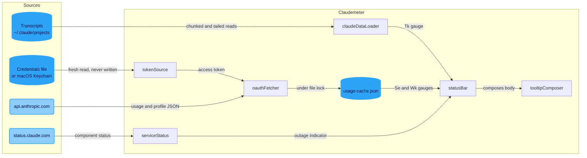

# Architecture

Claudemeter is a VS Code extension that shows three gauges in the status bar: Se (session usage), Wk (weekly usage) and Tk (context tokens in the active Claude Code session). It reads what Claude Code already holds on disk and calls two Anthropic hosts. It owns no credentials and has no runtime dependencies.

Blue cylinders are datastores. Pale rounded boxes are external hosts.

## Data sources

- Tk comes from the Claude Code transcripts for the workspace, taking the live interactive session with the most context. `claudeDataLoader` reads in 1 MB chunks and tails new bytes on later reads, because a multi-day transcript is too long to decode whole.
- Se and Wk come from `GET /api/oauth/usage`, made with Claude Code's own OAuth token. `tokenSource` re-reads the store on every fetch and never refreshes, since a second refresher invalidates Claude Code's rotating refresh token.
- Service status reads the Claude Code and Claude API components from `status.claude.com`, so a console-only incident does not show as an outage.

## Refresh model

- Usage refetches on a timer (`usageRefreshSeconds`, 30 to 3600, default 120).
- Tk refreshes on a local timer (`localRefreshSeconds`, 5 to 60) and when a file watcher sees a transcript change. Watcher events are debounced by 500 ms, because one turn fires a burst of writes.
- Service status polls every 5 minutes.

## Multi-window coordination

Every VS Code window runs its own copy. Web usage is the same for all windows on an account, so `usageCache` stores one entry in `usage-cache.json` in the claudemeter config dir. A window reads it while it is fresh, and otherwise fetches under an exclusive `.lock` file so concurrent windows make one request. On a 429 or timeout it serves the last cached value, and an entry tagged with another account reads as empty.

`sessionTracker` shares `session-data.json` the same way. It re-reads inside each update, merges sessions by id, and writes by temp file and rename.

## Remote windows

The extension declares `extensionKind: ["workspace","ui"]`, so in a remote window VS Code runs it on the remote host, beside Claude Code. Transcripts, the credential store and the login terminal are then all on the same machine. When it is installed only on the client, VS Code runs it there, and `clientSideRemoteName()` hides Tk, because a remote workspace path would resolve against the client's disk and could pick up an unrelated local project.

## Security notes

- The tooltip is trusted only for the two Nopilot commands, through `isTrusted: { enabledCommands }`. Plain `isTrusted: true` would run any `command:` link in text that came from outside.
- Account, plan, error and status-feed strings pass through `escapeMarkdown` before they reach a tooltip.
- The debug settings (`debug`, `debugLogFile`, `debugLogMaxSizeKB`) are machine-scoped, so a workspace cannot turn on logging or redirect the log file.
- Logs and Dump State carry token presence, never the token, and strip the home directory from paths.
